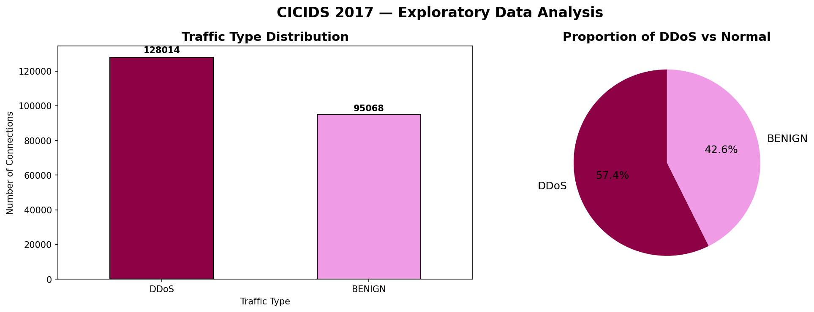
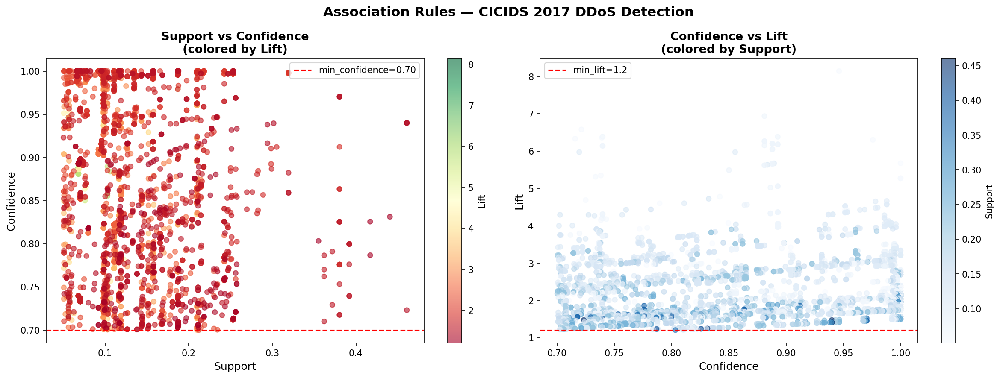
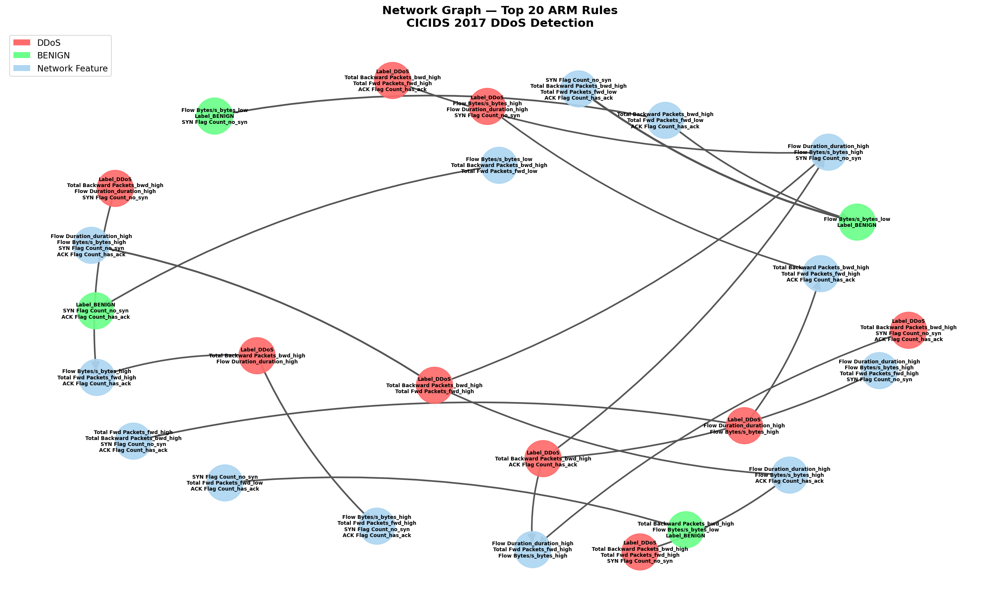

# 🔐 Association Rule Mining — DDoS Detection
## CICIDS 2017 Dataset | UKM FTSM 2026

## 👩🏾‍💻 About Me
I'm **Oumou N'Daou**, a Master 2 student  at CY Cergy Paris Université, currently on a semester exchange at the 
**Faculty of Information Science and Technology (FTSM), Universiti Kebangsaan 
Malaysia (UKM)** in Bangi, Malaysia.

I'm passionate about **Data Engineering**, **AI Engineering**, and 
**Cybersecurity** — building data-driven tools that solve real-world problems. 
This project is part of my Data Mining coursework at UKM and reflects my 
interest in applying machine learning techniques to cybersecurity challenges.

> 💡 Also working on: **WiskLedger AI** — a SaaS platform that translates 
> CVSS scores into financial risk for CISOs and CFOs.

---

## 📌 Project Overview
This project applies **Association Rule Mining (ARM)** to the CICIDS 2017 
network intrusion detection dataset to automatically discover behavioral 
patterns associated with **DDoS attacks** — without relying on manually 
crafted detection rules.

The goal is to identify which combinations of network flow features 
(protocol, packet counts, flag counts, flow duration) are strongly 
associated with DDoS attack traffic, enabling **proactive and automated 
threat detection** in cybersecurity systems.

---

## 🔬 Key Results

| Metric | Value |
|--------|-------|
| Dataset Size | 225,745 network connections |
| Frequent Itemsets (FP-Growth) | 798 |
| Association Rules Generated | 3,319 |
| Strong Rules (conf ≥ 0.85, lift ≥ 3.0) | 799 |
| Best DDoS Rule Lift | 7.14 (Confidence: 100%) |
| Best BENIGN Rule Lift | 8.14 (Confidence: 94.6%) |

### 🏆 Algorithm Comparison

| | Apriori | FP-Growth |
|-|---------|-----------|
| Sample Size | 2,000 rows | 5,000 rows |
| Execution Time | 0.15s | 0.23s |
| Itemsets Found | 796 | 798 |
| Approach | Candidate generation | FP-Tree compression |

**FP-Growth processed 2.5x more data in comparable time** 

---

## 🗂️ Dataset
- **Source:** CICIDS 2017 — University of New Brunswick (UNB)
- **Link:** https://www.unb.ca/cic/datasets/ids-2017.html
- **File:** Friday-WorkingHours-Afternoon-DDos.pcap_ISCX.csv
- **Classes:** DDoS (57.4%) + BENIGN (42.6%)
- **Features used:** Flow Duration, Fwd/Bwd Packets, 
Flow Bytes/s, SYN Flag Count, ACK Flag Count

---

## 🛠️ Technologies Used
- **Python 3.12**
- **pandas & numpy** — Data manipulation and cleaning
- **matplotlib & seaborn** — Data visualization
- **mlxtend** — Apriori + FP-Growth algorithms
- **networkx** — Network Graph visualization
- **scikit-learn** — Stratified sampling

---

## 📁 Project Structure
---

## 📊 Visualizations

### Traffic Distribution

### Association Rules — Scatter Plot

### Network Graph — Top 20 Rules

---

## 🔍 Key Findings
- **DDoS Signature:** High flow duration + high backward packets + 
no SYN flag → DDoS (Confidence: 100%, Lift: 7.14)
- **BENIGN Signature:** ACK present + no SYN + low forward packets 
+ high backward packets → Normal traffic (Confidence: 94.6%, Lift: 8.14)
- **96.5%** of all connections have no SYN flag — 
most flows are mid-session captures
- Strong rules represent **genuine behavioral signatures**, 
not random correlations (mean lift: 2.72x)

---

## 🚀 Other Projects
- **WiskLedger AI** — Cybersecurity finance SaaS platform translating 
CVSS scores into financial risk for CISOs and CFOs *(in development)*

---

## 🎓 Academic Context
- **Student:** N'Daou Oumou | ID: A222664
- **Programme:** Master 2  — CY Cergy Paris Université
- **Exchange:** Faculty of Information Science and Technology, 
Universiti Kebangsaan Malaysia (UKM)
- **Course:** Data Mining | 2026
